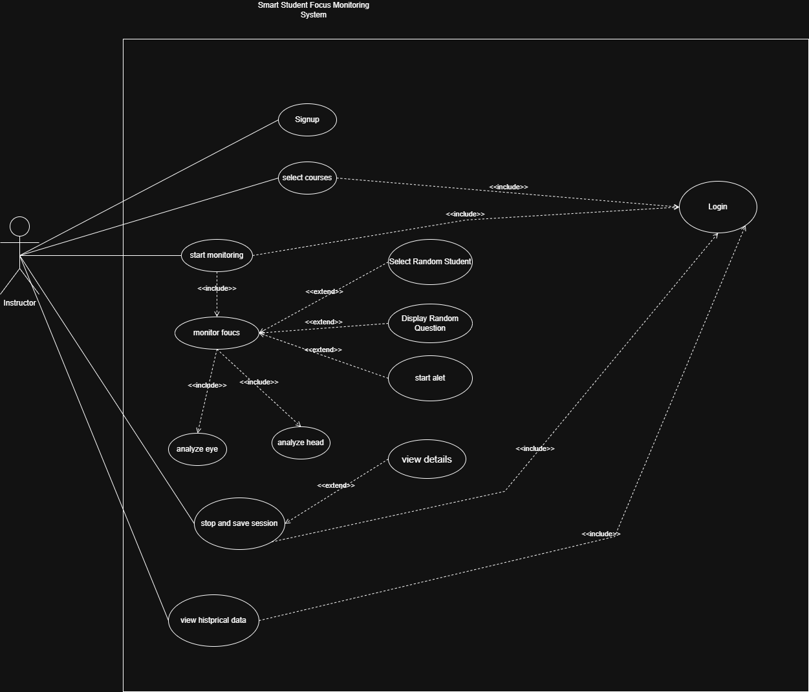
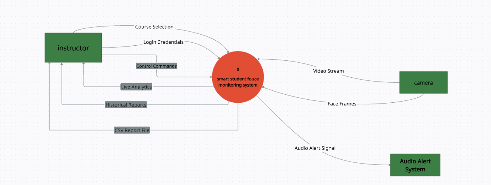
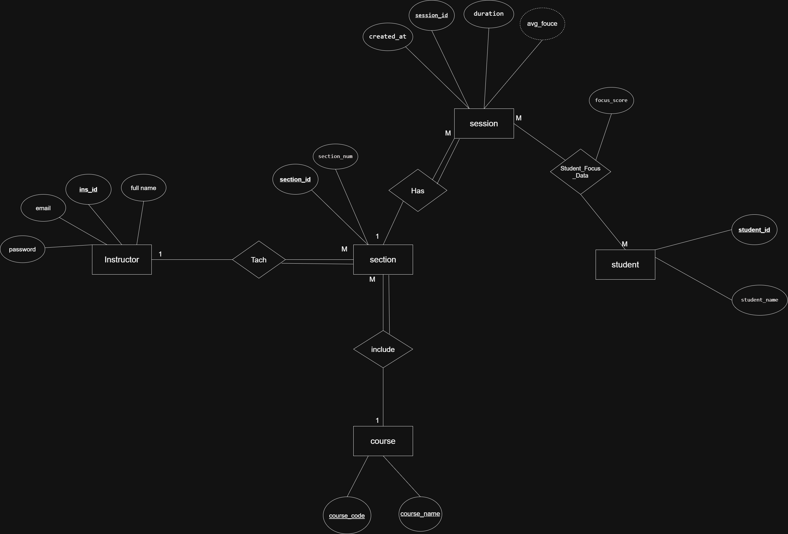

# Smart Student Focus Monitoring (SSFM)

A Flask web app that helps instructors see how focused a class is during a lecture. A webcam feed is analysed in real time with computer vision, each detected face gets a live focus score, and sessions are saved so instructors can review reports and history later.

Graduation project at Yarmouk University (team project). **My role:** full-stack web application - Flask backend, SQLite database, instructor sign-up/sign-in, live monitoring page, lecture reports and history dashboards - and integrating the team's computer-vision module into it.

## Features

- **Instructor accounts:** sign up / sign in with hashed passwords (Werkzeug).
- **Courses and sections:** each instructor sees their own courses and starts monitoring a section.
- **Live monitoring:** webcam stream with a box and focus percentage per detected face (up to 5 faces), plus a class average.
- **Focus scoring:** built from eye openness (eye aspect ratio from MediaPipe Face Mesh landmarks) and head tilt - a score drops when eyes stay closed or the head stays turned away, and recovers gradually when attention returns.
- **Audio alert:** a sound plays when the class average falls below 50%.
- **Random student highlight:** a button picks one detected student at random.
- **Reports and history:** each session is saved (average focus, duration, per-student scores) and can be reviewed per lecture and over time.

## Background and goals

Instructors usually judge attention by eye, which is subjective and hard to do for a whole room, especially in long lectures where students get tired or bored. This project explores an objective, real-time alternative: use a camera and computer vision to estimate how focused each student and the whole class are, give the instructor live feedback, and keep a history for later review.

Goals:
1. Estimate focus per student and for the class in real time.
2. Give the instructor an interactive dashboard with individual and class-level focus.
3. Raise an alert when class attention drops.
4. Store past sessions and show detailed reports per lecture.

## Requirements (summary)

**Functional:** instructor sign-up and login; list of the instructor's courses; start and stop a monitoring session for a chosen course section; live focus percentages per student and for the class; audio alert below a threshold; save a session with "Stop and Save"; history of past lectures and a detailed report for each.

**Non-functional:** near real-time processing, a simple interface, protected credentials, and a structure that can grow to more courses and students.

## System design

The analysis and design phase produced three diagrams.

**Use case diagram** - the instructor can sign up, log in, select a course, start monitoring (eye and head analysis, random student selection, alert), stop and save the session, and view history and details.



**Context diagram** - the system exchanges course selection and login credentials with the instructor, receives the video stream from the camera, and sends an audio alert signal to the alert system.



**Entity-relationship diagram** - an instructor teaches many sections, each section belongs to a course and has many sessions, and each session stores one focus score per student.



### Database

SQLite with six tables: `instructors`, `courses`, `sections` (links a course to an instructor), `students`, `sessions` (average focus, duration and timestamp per lecture) and `student_focus_data` (focus score per student per session). See `database.py` for the schema.

## Tech stack

Python, Flask, SQLite, OpenCV, MediaPipe, NumPy, Pygame; HTML/CSS/JavaScript front end.

## Run it locally

You need Python 3 and a webcam.

```bash
pip install -r requirements.txt
python database.py          # creates smart_focus.db with the schema
python seed_demo_data.py    # adds a demo instructor, courses and fake students
python app.py
```

Open http://127.0.0.1:5000 and sign in with the demo account: `demo@example.com` / `demo123`.

Optional environment variables: `SECRET_KEY` (Flask session key - set it for anything beyond a local demo) and `FLASK_DEBUG=1`.

## Project structure

```
app.py               Flask app, video stream, focus scoring, routes
database.py          SQLite schema (instructors, courses, sections, students, sessions, focus data)
seed_demo_data.py    Demo data (fake instructor and students)
templates/           HTML pages
static/              Logo images and alert sound
docs/diagrams/       ERD, use case and context diagrams
```

## Privacy

Video is processed live and frames are not saved by the app. The repository contains no real student or instructor data - the demo database is created from fake data by `seed_demo_data.py`.

## Limitations

- Focus is estimated from face landmarks only (eye openness and head pose), so it is a rough indicator, not a measure of real attention. The original design also considered facial expressions and audio interaction, which are not part of this implementation.
- Uses one webcam and is designed for a small group of visible faces.
- Student identities in the demo are placeholders; there is no face recognition.
- Basic authentication only (no CSRF protection or password reset) - not production-ready.
